<p align="center">
  
</p>

<p align="center">
  
  
  
  
  
</p>
<p align="center">
  
  
  
  
</p>

<p align="center">
  <b>KisanMitra</b> (किसान मित्र, <i>"the farmer's friend"</i>) is a mobile-first web app for Indian farmers.<br/>
  Photograph a sick leaf and get the disease, a confidence score and a treatment plan in about a second,<br/>
  then ask follow-up questions to an AI farming assistant in English or Hindi.
</p>

<p align="center">
  <a href="#see-it-in-action">See it in action</a> ·
  <a href="#features">Features</a> ·
  <a href="#how-it-works">How it works</a> ·
  <a href="#accuracy">Accuracy</a> ·
  <a href="#architecture">Architecture</a> ·
  <a href="#quick-start">Quick start</a> ·
  <a href="#deploy-on-aws">Deploy on AWS</a> ·
  <a href="#api">API</a> ·
  <a href="#roadmap">Roadmap</a>
</p>

---

## See it in action

<p align="center">
  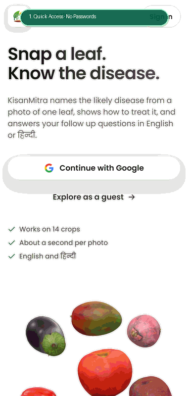
  <br/>
  <sub><b>Interactive Walkthrough: 1-Tap Access, Dashboard, Leaf Scanner, AI Diagnosis & Spray Forecast</b></sub>
</p>

### Current Interface Design

<table align="center">
  <tr>
    <td align="center">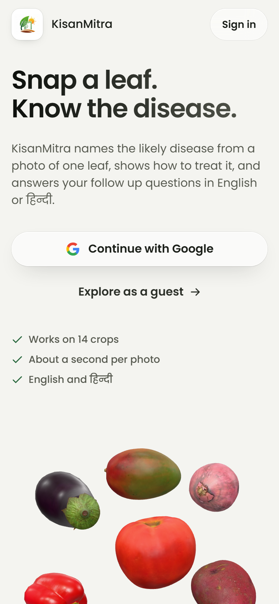<br/><sub><b>Landing Page</b></sub></td>
    <td align="center">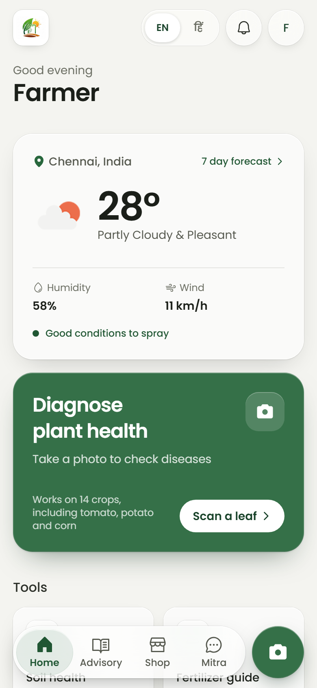<br/><sub><b>Home Dashboard</b></sub></td>
    <td align="center">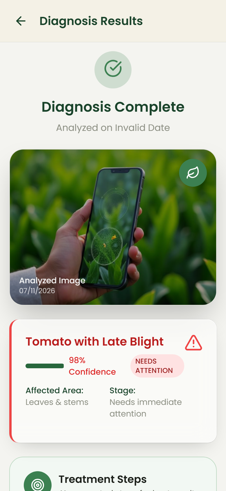<br/><sub><b>Diagnosis & Treatment</b></sub></td>
    <td align="center">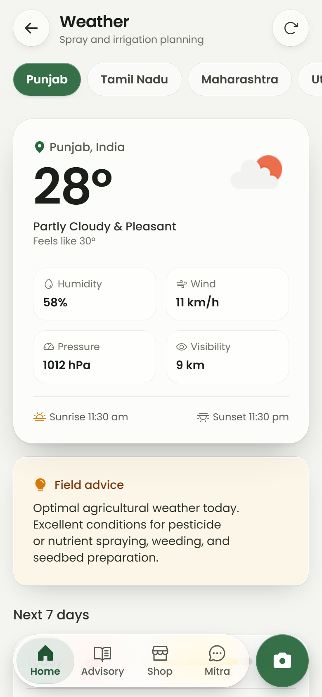<br/><sub><b>Weather & Spray Radar</b></sub></td>
  </tr>
  <tr>
    <td align="center">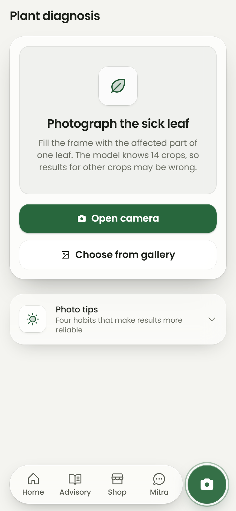<br/><sub><b>Camera Scanner</b></sub></td>
    <td align="center">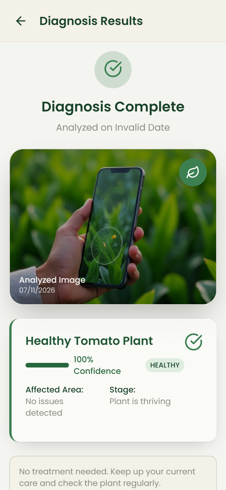<br/><sub><b>Healthy Plant</b></sub></td>
    <td align="center">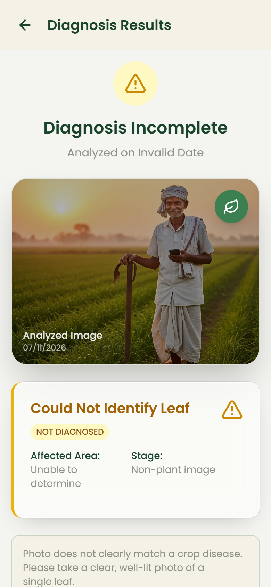<br/><sub><b>Honest Quality Gate</b></sub></td>
    <td align="center">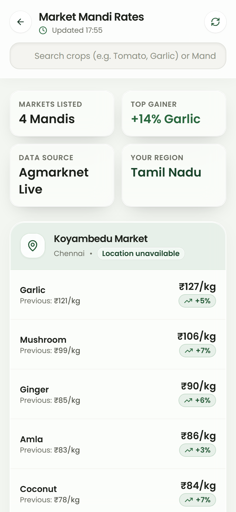<br/><sub><b>Mandi Rates</b></sub></td>
  </tr>
</table>

<p align="center"><sub>Screenshots captured from the live application deployment.</sub></p>

## Features

| Feature | What it does |
|---|---|
| **Plant disease detection** | MobileNetV2 trained on PlantVillage recognises 38 diseases and healthy states across 14 crops, with a real confidence score |
| **Honest "not sure"** | Below 75% confidence it asks for a better photo instead of guessing, so farmers aren't sent to buy the wrong pesticide |
| **Gemini second opinion** | Unclear photos go to Gemini, which can also cover crops outside the model's 14, and is told to reject photos that aren't plants |
| **Treatment plans** | Step-by-step treatment and fertilizer suggestions for the diagnosed disease, saved to *My Treatments* |
| **Mitra, the farming assistant** | Chat about crops, pests, soil, irrigation and markets, tuned for Indian conditions, with voice input |
| **Weather & Spray Forecast** | Local forecasts from OpenWeatherMap to plan spraying, irrigation, and weather risk management |
| **Marketplace & guides** | Shop, sell produce, market prices, crop guides, soil health, nearby fertilizer shops |
| **English & Hindi** | Complete interface in English and Hindi with a one-tap language switch |
| **Android-ready** | Capacitor configuration included for packaging as a native Android app |

## How it works

<p align="center">
  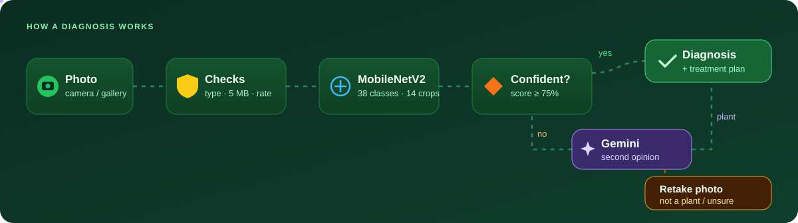
</p>

1. **Shrink in the browser.** Gallery photos are resized to 1600 px before upload. In testing, a 4.9 MB photo was sent as 0.7 MB.
2. **Check on the server.** The file must really be a JPEG, PNG or WebP (checked by its contents, not its name), at most 5 MB and 50 megapixels, and each IP gets 20 requests a minute.
3. **Classify.** The [`linkanjarad/mobilenet_v2_1.0_224-plant-disease-identification`](https://huggingface.co/linkanjarad/mobilenet_v2_1.0_224-plant-disease-identification) model runs on CPU inside the container, baked into the Docker image at build time.
4. **Decide.** At 75% confidence or more, the farmer gets the diagnosis and a treatment plan. Below that, Gemini gets a look; if it isn't confident it's a plant either, the farmer is asked to retake the photo.
5. **Store.** The original photo is saved to a private S3 bucket.

> **Bring your own model.** Drop a trained Keras `.h5` file at `backend/models/plantvillage_mobilenetv2.h5` (or set `PLANT_MODEL_PATH`) and it replaces the Hugging Face model. Files with untrained, randomly initialised weights are detected and refused at startup.

## Accuracy

<p align="center">
  
</p>

Measured through the real `/api/diagnose` endpoint on 380 labelled photos from the PlantVillage dataset (10 per class):

| Result | Photos |
|---|---|
| Correct | 347 |
| Wrong | 7 |
| Declined as "Could not identify" | 26 |

> [!NOTE]
> PlantVillage photos are single leaves on plain backgrounds, and some may have been part of the model's training data. Expect lower accuracy on real field photos with soil, shadows and several leaves in frame. The model covers 14 crops: **apple, blueberry, cherry, corn, grape, orange, peach, bell pepper, potato, raspberry, soybean, squash, strawberry and tomato.** Rice, wheat and cotton are not in the dataset. Photos of them may be misidentified, or, when the model is unsure and a Gemini key is set, answered by Gemini instead.

## Architecture

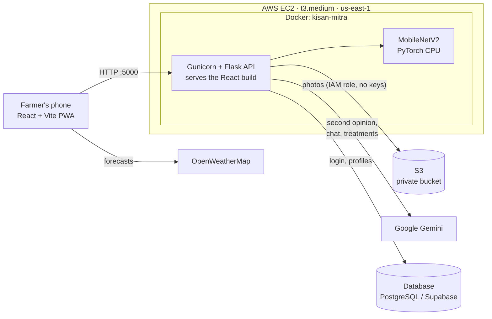

## Tech stack

| Layer | Tools |
|---|---|
| **Frontend** | React 18, TypeScript, Vite, Tailwind CSS, shadcn/ui, React Router, i18next, Capacitor, Three.js |
| **Backend** | Python 3.11, Flask, Gunicorn, Flask-Limiter, Pillow |
| **AI** | Hugging Face Transformers + PyTorch (CPU), optional Keras/TensorFlow, Google Gemini |
| **Cloud** | AWS EC2, S3, IAM instance role, Docker Compose |
| **Data & auth** | Firebase Authentication, PostgreSQL / Supabase |

## Quick start

### With Docker (recommended)

```bash
git clone https://github.com/loadingscreen78/KISAN-Mitra-.git
cd KISAN-Mitra-
cp .env.example .env          # add your keys, see the table below
docker compose up -d --build  # first build takes a few minutes
```

Open **http://localhost:5000**. The model is downloaded during the build, so the app is ready as soon as the container starts.

### For development

```bash
# Frontend (http://localhost:5000, forwards /api to the backend)
npm ci
npm run dev

# Backend (http://localhost:8000), in a second terminal. Python 3.11 is recommended.
python -m pip install -r requirements.txt
python backend/plant_diagnosis_api.py
```

<details>
<summary><b>Environment variables</b></summary>

<br/>

Put these in `.env`. It's git-ignored, so keys never get committed. Everything is optional: plant disease detection works with none of them.

| Variable | Used for |
|---|---|
| `GEMINI_API_KEY` | Second opinions, chat, treatment steps and fertilizer suggestions |
| `GEMINI_MODEL` | Override the Gemini model (default `gemini-3.5-flash`) |
| `S3_BUCKET` | Save uploaded photos to this S3 bucket |
| `AWS_DEFAULT_REGION` | Region of the bucket, e.g. `us-east-1` |
| `SUPABASE_URL`, `SUPABASE_ANON_KEY`, `SUPABASE_SERVICE_ROLE_KEY` | Sign-up, login and profiles |
| `DATABASE_URL` | Diagnosis history |
| `VITE_OPENWEATHERMAP_API_KEY` | Weather page (read at build time) |
| `PLANT_MODEL_PATH` | Path to your own trained Keras `.h5` model |
| `HF_TOKEN` | Not needed; the plant model is public |
| `REPLICATE_API_TOKEN` | Optional server-side text-to-speech |

On AWS, leave out AWS access keys entirely. The EC2 instance's IAM role gives the container S3 access.

</details>

<details>
<summary><b>Tests</b></summary>

<br/>

```bash
python -m pytest tests/test_upload_limits.py -q
```

21 tests covering file type checks (including files that lie about their type), the 5 MB and pixel limits, per-IP rate limits on every AI endpoint, Gemini timeouts, and the rule that Gemini can't override with a non-plant answer.

</details>

## Deploy on AWS

<details open>
<summary><b>EC2 + Docker + S3, step by step</b></summary>

<br/>

1. **Launch EC2:** Ubuntu, `t3.medium` (2 vCPU, 4 GB) or larger, 20 GB disk.
2. **Security group:** SSH (22) from **your IP only**, and Custom TCP **5000** from `0.0.0.0/0` for the app.
3. **IAM role:** attach a role that can write to your bucket (`LabInstanceProfile` in AWS Academy labs).
4. **S3:** create a bucket with *Block all public access* on.
5. **Install Docker** on the instance, copy or clone this repo, then:

```bash
cat > .env <<'EOF'
S3_BUCKET=your-bucket-name
AWS_DEFAULT_REGION=us-east-1
EOF
chmod 600 .env
docker compose up -d --build
```

6. Open `http://<public-ip>:5000`. The container is set to start again after a reboot (`restart: unless-stopped`) and is capped at 1.8 GB of memory so it can share the instance.

To add a Gemini key without it showing up in your shell history or process list:

```bash
read -rs GEMINI && sed -i '/^GEMINI_API_KEY=/d' .env && printf 'GEMINI_API_KEY=%s\n' "$GEMINI" >> .env && unset GEMINI
docker compose up -d
```

> **Tip:** The public IP changes whenever the instance stops and starts. Attach an Elastic IP for a stable address.

</details>

## API

| Method | Endpoint | Description | Limit |
|---|---|---|---|
| `POST` | `/api/diagnose` | Diagnose a photo. JSON `{"image_data": "<base64>"}` or multipart `file` | 20/min · 200/h per IP |
| `POST` | `/api/chat` | Ask Mitra a farming question: `{"message": "..."}` | 20/min · 200/h per IP |
| `POST` | `/api/treatment/steps` | Treatment steps for `{"disease": "..."}` | 20/min · 200/h per IP |
| `POST` | `/api/treatment/fertilizers` | Fertilizer suggestions for `{"disease": "..."}` | 20/min · 200/h per IP |
| `POST` | `/api/voice-chat` | Chat reply for voice mode | 20/min · 200/h per IP |
| `POST` | `/api/auth/register`, `/api/auth/login` | Account sign-up and login | |
| `GET` | `/health` | Health check used by Docker | |

<details>
<summary><b>Example diagnosis response</b></summary>

<br/>

A real response for an apple leaf with scab:

```json
{
  "success": true,
  "result": {
    "disease": "Apple Scab",
    "confidence": 99.6,
    "status": "not_healthy",
    "is_healthy": false,
    "model_used": "huggingface_transformer",
    "all_predictions": [
      { "disease": "Apple Scab", "confidence": 99.6 },
      { "disease": "Peach with Bacterial Spot", "confidence": 0.2 },
      { "disease": "Healthy Apple", "confidence": 0.1 }
    ],
    "treatment": "Apply fungicides during wet weather. Improve air circulation. Remove fallen leaves."
  }
}
```

When S3 is enabled the result also includes `image_key`, the photo's location in the bucket.

Rejected uploads return `400` with a readable `error`, oversize requests `413`, and too many requests `429`.

</details>

## Security

- **Uploads are checked by content:** only real JPEG, PNG and WebP files, up to 5 MB and 50 megapixels.
- **Per-IP rate limits** on every endpoint that runs a model or calls Gemini, so nobody can drain the API quota.
- **Private photo storage:** the S3 bucket blocks all public access, and the server reaches it through an IAM role, not stored keys.
- **No secrets in git:** `.env`, `*.pem`, `*.key` and model files are ignored, and the Docker image doesn't include `.env`.
- **No URL fetching:** the server never downloads images from user-supplied URLs.
- **Hard timeouts:** each Gemini call is capped at 20 seconds, so a slow response can't hang the app.

## Roadmap

- [x] Plant disease detection with honest confidence scores
- [x] Gemini second opinion that refuses non-plant photos
- [x] Docker image with the model built in
- [x] Deployed on AWS EC2 with private S3 photo storage
- [x] Upload checks and per-IP rate limits
- [ ] Replace Supabase with AWS RDS PostgreSQL and our own login
- [ ] Run on Kubernetes (k3s)
- [ ] CloudWatch metrics, logs, alarms and a dashboard
- [ ] HTTPS and a stable address, so the live camera works on phones
- [ ] Fine-tune on field photos and add rice, wheat and cotton

## Project structure

```text
KISAN-Mitra-/
├── backend/
│   ├── plant_diagnosis_api.py   # Flask API: diagnosis, chat, treatments, upload limits
│   ├── plant_model.py           # Optional local Keras .h5 model loader
│   ├── auth_endpoints.py        # Sign-up and login
│   └── supabase_db.py           # Database access
├── src/
│   ├── pages/                   # 36 screens: Diagnose, Mitra, Weather, Shop, ...
│   ├── components/              # UI components (shadcn/ui)
│   └── locales/                 # en.json, hi.json
├── tests/                       # pytest suite
├── docs/assets/                 # README graphics, tutorial gif, and screenshots
├── Dockerfile                   # Builds the frontend, then the API image with the model
├── docker-compose.yml           # One-command deployment
└── requirements.docker.txt      # Slim, CPU-only Python dependencies for the image
```

## Contributing

Contributions are welcome. See [CONTRIBUTING.md](CONTRIBUTING.md) for how to get started, and open an issue first for big changes.

## Team

Originally built by the Kisan Mitra team. Maintainer: [Dasarigalla-Raviteja](https://github.com/Dasarigalla-Raviteja). See [CONTRIBUTORS.md](CONTRIBUTORS.md) for everyone involved.

## Acknowledgements

[PlantVillage](https://github.com/spMohanty/PlantVillage-Dataset) for the dataset · [linkanjarad](https://huggingface.co/linkanjarad) for the trained MobileNetV2 · Google Gemini · Hugging Face · shadcn/ui · OpenWeatherMap · and the farmers who inspired this project.

The 3D produce models and crop renders in `public/models/produce/` are derived from [NVIDIA SimReady Assets](https://huggingface.co/datasets/nvidia/simready-assets) under [CC BY 4.0](https://creativecommons.org/licenses/by/4.0/); see that folder's `ATTRIBUTION.md` for the asset list and changes made.

## License

[MIT](LICENSE) © 2025 Kisan Mitra Team

<p align="center">
  
</p>
